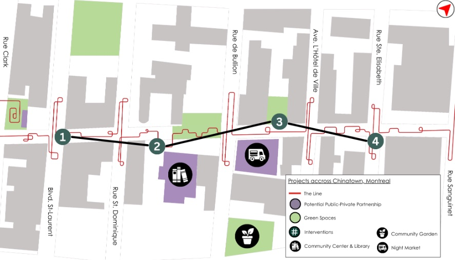
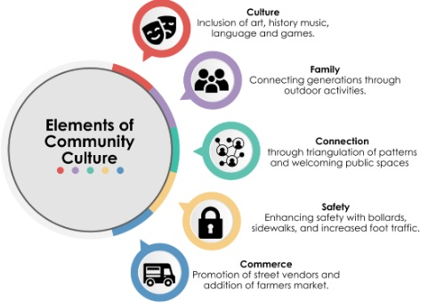

<dl class="fact-strip chinatown-facts">
  
<dt>Location</dt><dd>Montréal, Québec</dd>

  
<dt>Project</dt><dd>Concordia University · URBS 333</dd>

  
<dt>Study period</dt><dd>September 2023 – May 2024</dd>

</dl>

<nav class="report-nav" aria-label="Report sections">
  <a href="#background-and-objective">Background</a>
  <a href="#methodology">Methodology</a>
  <a href="#corridor-strategy">Corridor strategy</a>
  <a href="#site-interventions">Site interventions</a>
  <a href="#implementation">Implementation</a>
</nav>

## Background and objective

The study examined how the eastern stretch of Rue de la Gauchetière could connect more clearly to the rest of Montréal’s Chinatown. Field observations and conversations with community members identified concerns about lighting, pedestrian safety, and continuity between blocks. The team focused on the conditions that shape the walk between destinations, including how people cross intersections, enter side passages, and find places to stop.

The objective was a pedestrian-priority corridor with slower vehicle movement where access is shared, clearer walking connections, and public spaces that support everyday use. This focus complements Ville-Marie’s broader priorities for public space, commercial vitality, and neighbourhood identity. [Ville de Montréal, L’avenir du Quartier chinois](https://montreal.ca/articles/lavenir-du-quartier-chinois-19928)

## Methodology

The team combined land-use observations, pedestrian accessibility audits, stakeholder interviews, and spatial organization in ArcGIS Online. Mapping the findings helped connect concerns about lighting, access, and safety to specific stretches of the corridor. The team then developed site concepts and tested how they could work together as a sequence.

Three planning ideas informed the design. Jane Jacobs’s *eyes on the street* encouraged attention to regular use and visibility from surrounding buildings. Jan Gehl’s human-scale approach helped frame the street around walking, seating, and everyday activity. Christopher Alexander’s patterns for outdoor space and local sports informed small spaces for informal play and intergenerational gathering.

## Corridor strategy

A continuous red pavement marking, called **The Line** in the concept plan, links intersections, side passages, and gathering spaces. Murals mark turns and entrances along the route. Lighting supports visibility, and activity nodes give people reasons to stop. The four proposed interventions are shown west to east below.

<figure class="corridor-diagram">
  

    
Rue de la Gauchetière

    <h3>Four interventions along one corridor</h3>
  

  
WestEast →

  <ol class="corridor-stops" role="list">
    <li><a href="#safer-crossing">1<strong>Safer crossing</strong>Boulevard Saint-Laurent</a></li>
    <li><a href="#art-and-wayfinding">2<strong>Art and wayfinding</strong>East of Rue Saint-Dominique</a></li>
    <li><a href="#outdoor-activity">3<strong>Outdoor activity</strong>Between Rue De Bullion and Avenue de l’Hôtel-de-Ville</a></li>
    <li><a href="#alley-mural">4<strong>Alley mural</strong>Near Rue Sainte-Élisabeth</a></li>
  </ol>
  <figcaption>Approximate locations, shown schematically. Select a stop to jump to its proposal.</figcaption>
</figure>

<figure class="chinatown-plate">
  
  <figcaption>The team’s concept plan shows how the four interventions relate to green spaces and potential partnerships.</figcaption>
</figure>

## Site interventions

  <figure id="safer-crossing">
    
    <figcaption><strong>1. Safer crossing</strong>Bollards and traffic calming define the transition to a pedestrian-priority section near Boulevard Saint-Laurent. Lighting helps make the route legible after dark.</figcaption>
  </figure>
  <figure id="art-and-wayfinding">
    
    <figcaption><strong>2. Art and wayfinding</strong>Painted pavement continues through side passages. Murals mark the entrances and help tie smaller spaces back to the main street.</figcaption>
  </figure>
  <figure id="outdoor-activity">
    
    <figcaption><strong>3. Outdoor activity</strong>A table-tennis table creates a reason to stay in a small public space. Seating and clear circulation give people room to play, watch, or rest.</figcaption>
  </figure>
  <figure id="alley-mural">
    
    <figcaption><strong>4. Alley mural</strong>A mural near Rue Sainte-Élisabeth creates a visible landmark at an alley entrance and extends the visual identity of the route eastward.</figcaption>
  </figure>

## Community design priorities

The concept links five priorities: connection through a legible route, culture through public art and neighbourhood programming, family activity through outdoor play, safety through clearer pedestrian spaces and lighting, and commerce through opportunities for local vendors. These priorities work together when people can move comfortably through the corridor and have places to spend time.

<figure class="chinatown-plate chinatown-plate--themes">
  
  <figcaption>Five design priorities from the capstone team’s original presentation.</figcaption>
</figure>

## Implementation

The concept plan proposes a night market in the parking area behind the Montreal Chinese Hospital and identifies opportunities for a community centre and library and a community garden. The market could begin as a temporary pilot with vendors, seating, and lighting. It would require coordination with the site owner, local businesses, and community groups, with a clear plan for hospital access, deliveries, and accessible pedestrian routes.

A pilot could track where people cross and stop, how the route functions after dark, and what residents, vendors, and people with mobility needs report after using it. That feedback would help determine which changes are worth making permanent.

<strong>Capstone team:</strong> Mélodie Ravonison, Audrey Smith, Shawn Paradis, Kourosh Moini, Julian Harris, and Cailey Nikodem. This report documents a collaborative student design proposal. The original concept illustrations were created by Kourosh Moini’s teammates.

