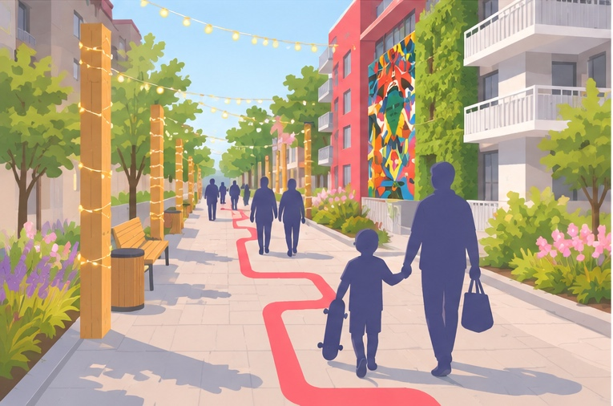
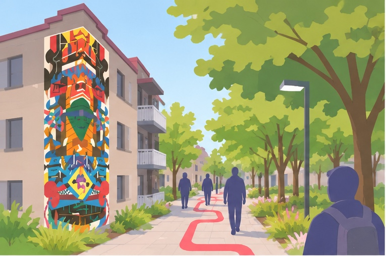
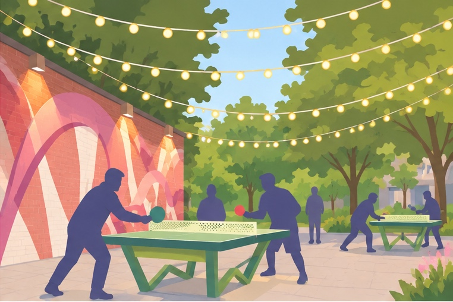

## Background and objective

The study examined how the eastern stretch of Rue de la Gauchetière could connect more clearly to the rest of Montréal’s Chinatown. Field observations and conversations with community members identified concerns about lighting, pedestrian safety, and continuity between blocks. The team focused on the conditions that shape the walk between destinations, including how people cross intersections, enter side passages, and find places to stop.

The objective was a pedestrian-priority corridor with slower vehicle movement where access is shared, clearer walking connections, and public spaces that support everyday use. The proposal brings together **community-informed research, pedestrian accessibility, and streetscape design**.

## Methodology

**Site analysis and accessibility.** The team conducted land-use observations and pedestrian accessibility audits along the eastern section of Rue de la Gauchetière. The site analysis looked at the relationship between street frontages, intersections, side passages, and potential gathering areas. The accessibility review focused on continuity along the walking route and the points where pedestrians cross, change direction, or share space with vehicles.

**Community interviews.** Interviews with community members and other stakeholders helped identify priorities for the street. The team considered concerns about lighting, pedestrian safety, and connections between blocks alongside the field observations. Those findings informed recommendations for clearer crossings, better-lit passages, and places where people could stop and spend time.

**GIS and design synthesis.** The team organized spatial findings in ArcGIS Online to relate observed conditions and interview themes to specific locations along the corridor. The concept plan translates that analysis into four site interventions and shows how the painted route connects them to green spaces and potential partnership sites. The research poster and presentation communicated the resulting accessibility, safety, and streetscape recommendations.

Three planning ideas informed the design. Jane Jacobs’s *eyes on the street* encouraged attention to regular use and visibility from surrounding buildings. Jan Gehl’s human-scale approach helped frame the street around walking, seating, and everyday activity. Christopher Alexander’s patterns for outdoor space and local sports informed small spaces for informal play and intergenerational gathering.

## Corridor strategy

A continuous red pavement marking, called **The Line** in the concept plan, links intersections, side passages, and gathering spaces. Murals mark turns and entrances along the route. Lighting supports visibility, and activity nodes give people reasons to stop. The four proposed interventions are shown west to east below.



## Site interventions

  <figure id="safer-crossing">
    
<a class="image-enlarge" href="/assets/uploads/chinatown-gateway/illuminated-path.jpg" data-image-viewer aria-label="Enlarge concept illustration">Enlarge ↗</a>

    <figcaption><strong>1. Safer crossing</strong>Bollards and traffic calming define the transition to a pedestrian-priority section near Boulevard Saint-Laurent. Lighting helps make the route legible after dark.</figcaption>
  </figure>
  <figure id="art-and-wayfinding">
    
<a class="image-enlarge" href="/assets/uploads/chinatown-gateway/mural-walkway.jpg" data-image-viewer aria-label="Enlarge concept illustration">Enlarge ↗</a>

    <figcaption><strong>2. Art and wayfinding</strong>Painted pavement continues through side passages. Murals mark the entrances and help tie smaller spaces back to the main street.</figcaption>
  </figure>
  <figure id="outdoor-activity">
    
<a class="image-enlarge" href="/assets/uploads/chinatown-gateway/ping-pong-courtyard.jpg" data-image-viewer aria-label="Enlarge concept illustration">Enlarge ↗</a>

    <figcaption><strong>3. Outdoor activity</strong>A table-tennis table creates a reason to stay in a small public space. Seating and clear circulation give people room to play, watch, or rest.</figcaption>
  </figure>
  <figure id="alley-mural">
    
<a class="image-enlarge" href="/assets/uploads/chinatown-gateway/mural-walkway.jpg" data-image-viewer aria-label="Enlarge concept illustration">Enlarge ↗</a>

    <figcaption><strong>4. Alley mural</strong>A mural near Rue Sainte-Élisabeth creates a visible landmark at an alley entrance and extends the visual identity of the route eastward.</figcaption>
  </figure>

## Implementation

The following steps are implementation considerations for the concept, rather than completed activities or measured outcomes.

The concept plan proposes a night market in the parking area behind the Montreal Chinese Hospital and identifies opportunities for a community centre and library and a community garden. The market could begin as a temporary pilot with vendors, seating, and lighting. It would require coordination with the site owner, local businesses, and community groups, with a clear plan for hospital access, deliveries, and accessible pedestrian routes.

A pilot could assess pedestrian crossing paths, where people stop, and how the route functions after dark. Feedback from residents, vendors, and people with mobility needs could inform which changes to retain. A detailed design review would also need to verify clear sidewalk widths, curb transitions, vehicle access, and how any bollards or seating affect the pedestrian route.

