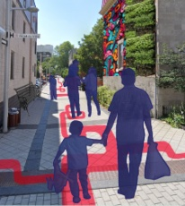
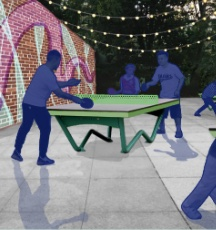

<dl class="fact-strip chinatown-facts">
  
<dt>Project</dt><dd>Concordia University planning capstone</dd>

  
<dt>Study period</dt><dd>September 2023 to May 2024</dd>

  
<dt>Location</dt><dd>Montréal, Québec</dd>

</dl>

## A more connected eastern stretch

Rue de la Gauchetière is a commercial and cultural gathering place in Montréal’s Chinatown. In Ville-Marie’s action plan, public space, commercial vitality, and cultural identity are linked priorities. Our capstone looked at one street within that broader context: how could the eastern stretch feel like a continuous part of Chinatown for people walking through it and for those who use it every day? [Ville de Montréal, L’avenir du Quartier chinois](https://montreal.ca/articles/lavenir-du-quartier-chinois-19928)

Our fieldwork and conversations pointed to gaps in lighting, walking comfort, and connections between blocks. We focused on what happens between destinations. A crossing should feel easy to read, an alley entrance should feel connected to the street, and people should have places to sit or spend time along the way.

## Fieldwork and mapping

I conducted land-use observations, pedestrian accessibility audits, and stakeholder interviews, and organized the spatial findings in ArcGIS Online. The team used that work to connect comments about lighting, safety, and walkability to specific locations. It informed our proposals for crossings, small gathering spaces, and a continuous route between them.

## The community corridor

The proposal uses a painted line, lighting, and public art to connect four interventions along Rue de la Gauchetière. Each addresses a different part of the walk. Together, they give people more reasons to continue east and more places to stop along the way.

<figure class="corridor-diagram">
  

    
Rue de la Gauchetière

    <h3>Four interventions along one corridor</h3>
  

  
WestEast →

  <ol class="corridor-stops" role="list">
    <li>1<strong>Safer crossing</strong>Boulevard Saint-Laurent</li>
    <li>2<strong>Art and wayfinding</strong>East of Rue Saint-Dominique</li>
    <li>3<strong>Outdoor activity</strong>Between Rue De Bullion and Avenue de l’Hôtel-de-Ville</li>
    <li>4<strong>Alley mural</strong>Near Rue Sainte-Élisabeth</li>
  </ol>
  <figcaption>Schematic redrawn from the team’s concept plan. Approximate locations, not to scale.</figcaption>
</figure>

Near Boulevard Saint-Laurent, the team proposed traffic calming and bollards to make the pedestrian route easier to read. Farther east, painted pavement and murals would carry that route across blocks and into side passages. At the outdoor activity space, a table-tennis table and seating would make room for informal play and for people who want to watch or rest.

  <figure>
    
    <figcaption>Painted pavement connects a side passage to the corridor.</figcaption>
  </figure>
  <figure>
    
    <figcaption>A small public space makes room for table tennis and informal gatherings.</figcaption>
  </figure>

## From a street concept to a pilot

The team also proposed testing a night market in the parking area behind the Montreal Chinese Hospital, alongside ideas for a combined community centre and library, and a separate community garden. A temporary market could test how vendors, seating, and an evening walking route fit together. It would require agreement with the site owner, coordination with local businesses and community groups, and a clear plan for keeping hospital access and pedestrian routes open.

I would start with a temporary pilot and look at how people cross, where they stop, and what residents, vendors, and people with mobility needs say after using it. Those observations would help determine which changes are worth making permanent.

<strong>Project team:</strong> Mélodie Ravonison, Audrey Smith, Shawn Paradis, Kourosh Moini, Julian Harris, and Cailey Nikodem. The illustrations are excerpts from the team’s capstone work. The corridor is a student design proposal.

